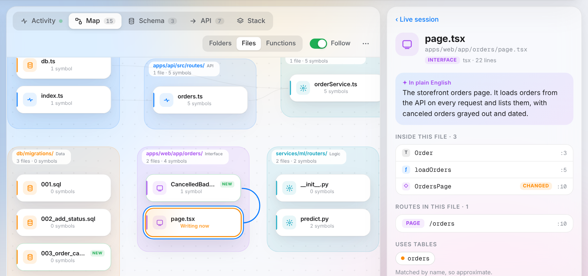
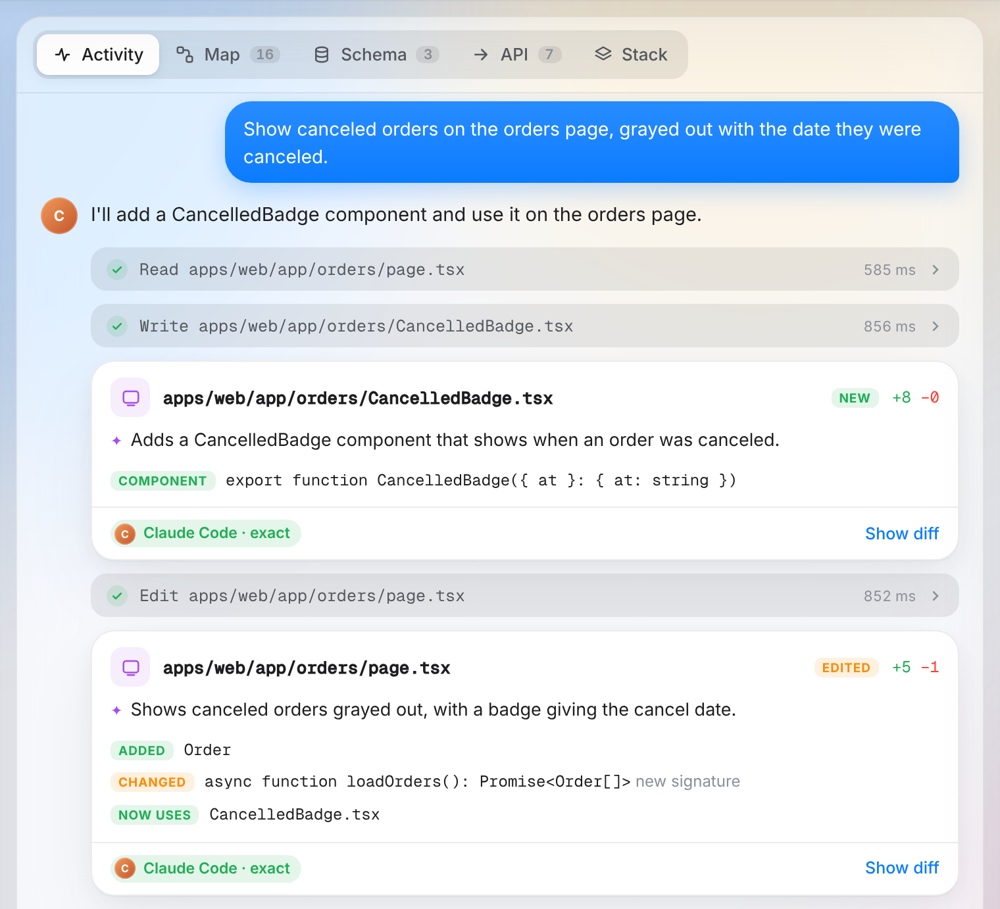
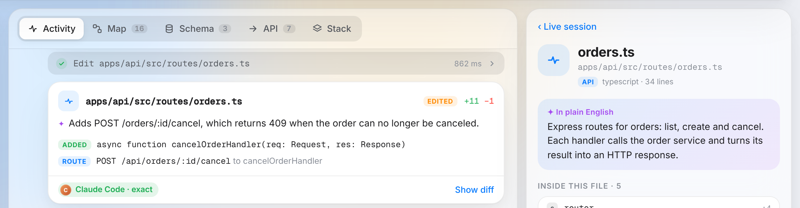
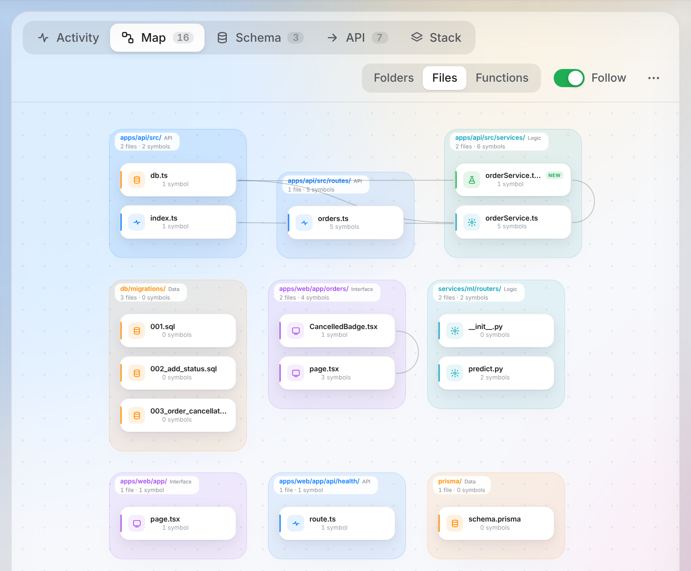
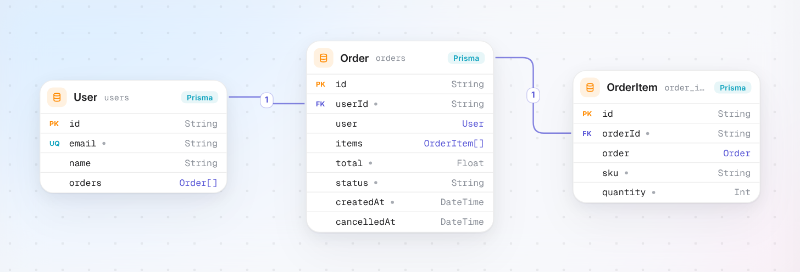
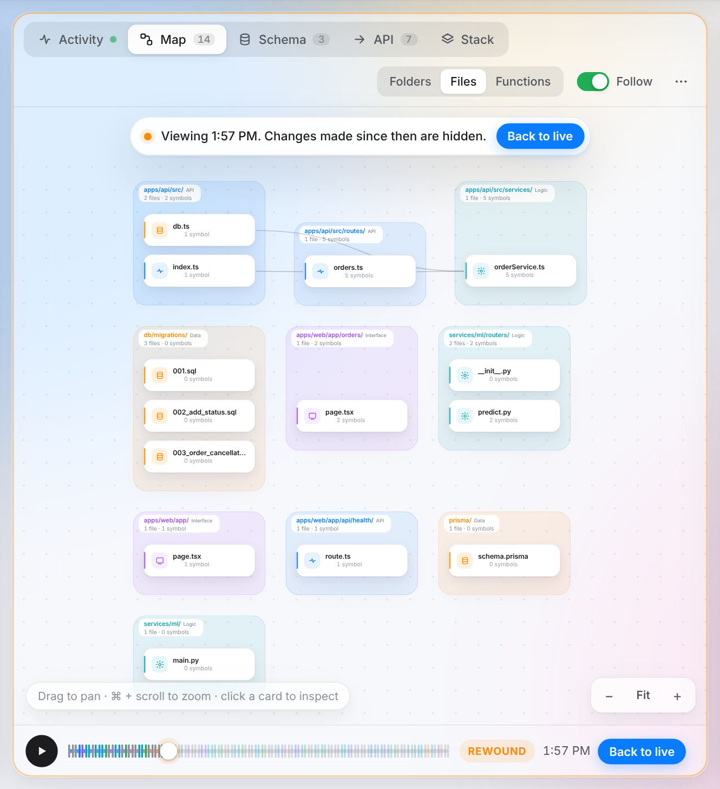

# LiveMap

See what your AI coding agent is building, live.

LiveMap watches your project while Claude Code, Codex, Cursor or a cloud builder works on it, and shows every file, function, route and table it touches as it happens. It runs locally as a CLI and a browser UI, so you can follow the build, rewind it, and flag or pause the agent when something looks wrong.



**Try the demo:** download `livemap-demo.html` from the [latest GitHub Release](https://github.com/Sahnijatin/livemap/releases/latest) and open it in a browser. No install needed. Its AI summaries are sample text written for the demo; real summaries need a provider you configure, such as your own API key or a local Ollama (see [AI summaries](docs/guide.md#ai-summaries)).

## Quickstart (from source)

Requires Node 18 or later. LiveMap is not on npm yet, so install it from this repo:

```sh
git clone https://github.com/Sahnijatin/livemap.git
cd livemap
npm install
npm run build
npm link              # puts the livemap command on your PATH
```

Then, in the project your agent works on:

```sh
livemap init          # adds hooks for the agents it finds
livemap               # indexes the project and opens the UI in your browser
```

`livemap init` sets up the agents whose config folder it finds; name them with `--agents claude,codex,cursor` if it finds none. If you would rather not use `npm link`, run `node <path-to-livemap>/dist/cli.js` instead of `livemap`. All commands and flags are in [the guide](docs/guide.md#command-line).

## What you get

**Activity feed.** The agent's prompts, messages and tool calls, with a card for every change: functions, routes and tables added, changed or removed, and the diff.



With AI summaries turned on (opt-in), change cards and the inspector also get a one-sentence summary in plain English.



**Map.** Every code file as a card in its folder, linked by imports. The file being written glows, new files spring in, and the camera follows the agent.



**Schema, API and Stack.** The tables, routes and technologies LiveMap found, each linked to its source line.



**Timeline.** Drag back through the session to see the whole project as it was at any moment, or replay it at eight times speed.



**Steering.** Flag a file or the project with a note, or pause the agent. The agent gets the note at its next tool call.

**Export.** `livemap export` writes the history as one HTML file that anyone can open offline. Add `--no-code` to leave out file contents, diffs and agent tool inputs and outputs, or `--session ID` to export one agent session.

## Works with

| Agent | How LiveMap connects |
|---|---|
| Claude Code | Hooks |
| Codex CLI | Hooks |
| Cursor | Hooks |
| Cloud builders | Git, via `--pull` |

Any other tool still shows up through its file changes. Details in [docs/agents.md](docs/agents.md).

## Privacy

LiveMap runs entirely on your machine: the server listens on `127.0.0.1` only, and its API needs a token that changes every run. History, settings and caches stay in `~/.livemap`. LiveMap keeps only the key names from `.env` files, never their values. Nothing leaves your machine unless you turn on AI summaries, which send code only to the provider you choose, or run with `--pull`, which contacts your git remote. Read [docs/privacy.md](docs/privacy.md) for what is stored, what is sent, and how to delete it all.

## Docs

- [Guide](docs/guide.md): the command line, the UI, history, summaries, exports and supported frameworks.
- [Agents](docs/agents.md): what `livemap init` writes, cloud builders, Flag and Pause, attribution.
- [Privacy](docs/privacy.md): what runs where, what is stored and sent.
- [How it works](docs/how-it-works.md): the architecture.
- [Contributing](CONTRIBUTING.md): building, testing and house rules.

## License

LiveMap is source-available under the MIT license with the [Commons Clause](https://commonsclause.com/) condition. In plain terms:

- You may use, modify and share LiveMap for free, including at work.
- Nobody may sell LiveMap, or sell a product or service whose value comes entirely or substantially from it. That includes paid hosting, consulting or support for LiveMap.

Because of that condition, LiveMap is not open source as the OSI defines it. This summary is not legal advice; the [LICENSE](LICENSE) file has the exact terms.

## Credits

The Map and Schema views are drawn with [React Flow](https://reactflow.dev) (MIT license) and laid out with [ELK](https://eclipse.dev/elk/) through elkjs (EPL-2.0 license). Motion uses [Framer Motion](https://github.com/motiondivision/motion) (framer-motion, MIT license), and the ⌘K palette uses [cmdk](https://github.com/pacocoursey/cmdk) (MIT license).
