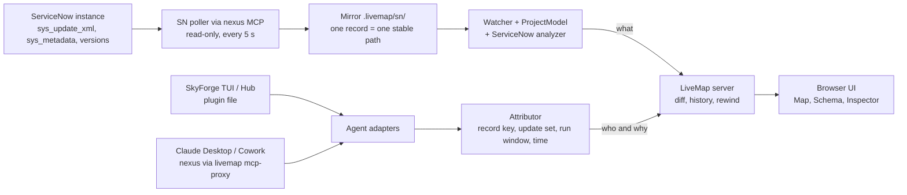

# LiveMap x SkyForge: ServiceNow Build Visibility

Design doc, 15 Oct 2026. Live version: https://claude.ai/code/artifact/26f39853-ffdc-403f-a9be-c72650774652 (this file is the repo copy; if they differ, the newer date wins). Tracking: epic #60, capture #62, related #48 to #59.

## Summary

LiveMap gets a ServiceNow source: it mirrors an instance scope to disk, maps records to its existing model, and attributes each change to the SkyForge session and tool call that made it. Today nobody can see what an agent built on an instance. The BharatBank POC scope holds 1,683 records, and 1,609 of them were last updated by `admin`, so the instance itself cannot say who built what or why.

What ships, in order:

1. **Backfill:** point LiveMap at a scope and get a map of every portal, page, widget, table, rule, flow and ACL, plus a timeline rebuilt from version history.
2. **Live mode:** changes made by SkyForge, Claude Desktop or a human show up within seconds, with diffs and rewind.
3. **Attribution:** each change carries the agent session, the tool call and the prompt that caused it, captured by the Claude Desktop MCP proxy and the SkyForge plugin.

SkyForge's code is not changed at any phase. LiveMap reads the instance through SkyForge's own nexus MCP. It captures tool calls through a plugin file dropped into `~/.skyforge/plugin/` (TUI and Hub) and a Claude Desktop MCP proxy (Desktop and Cowork). Scope for v1 is the user's own sessions; teammates' changes still appear, labelled by ServiceNow user.

## How it works day to day

1. Start SkyForge as usual (it is kept running from cmd): Claude Desktop or Cowork with the nexus MCP, or the SkyForge TUI.
2. Run `livemap sn --instance inmorphisdemo3 --scope <app>`. LiveMap opens in a browser tab; keep it on a second screen.
3. LiveMap asks nexus for the scope's records (read-only queries) and draws the map: portals, pages, widgets, tables, rules, flows.
4. While you build, two hooks report every SkyForge tool call to LiveMap:
    - **TUI and Hub:** the `livemap-skyforge` plugin file in `~/.skyforge/plugin/` (#62).
    - **Claude Desktop and Cowork:** the nexus entry in Claude Desktop's MCP config runs through `livemap mcp-proxy`, which forwards everything to nexus unchanged (#62).
5. Every few seconds LiveMap polls the instance for changes, matches each change to the tool call that made it, and updates the map, diffs and timeline.
6. Click any record to see its diff, update set, the tool call, and the prompt or step behind it.

If LiveMap is closed, both hooks pass everything through untouched.

### Decisions (15 Oct 2026)

| Question | Decision |
| --- | --- |
| How is SkyForge driven? | Mostly Claude Desktop and Cowork with nexus; some TUI |
| Which ServiceNow user does SkyForge act as? | Any user with the required roles, admin included; not fixed |
| How does LiveMap read the instance? | Through SkyForge's nexus MCP, no separate credentials |
| Whose "why" is shown? | The user's own sessions (TUI and Desktop) for now |
| Packaging | Open core, `plugins/servicenow` in this repo |
| SDK / Fluent apps in git | No, instance only |
| Hooks allowed | Plugin file and Claude Desktop MCP proxy; no SkyForge code changes |

## Background

### LiveMap today (v0.1.0, commit 5b82a24)

Structure comes from a chokidar watcher, tree-sitter symbols, regex imports and domain analyzers. Agent activity comes from Claude Code transcripts, Codex and Cursor hooks, and git polling, all feeding `AgentHub`. Attribution links a file change to a write tool call naming that path within -10 s to +5 s (exact), else to any event in the last 15 s (likely).

Gaps that matter here: the engine reads only the local filesystem (#52); MCP tool calls never count as writes (#49); shell and script calls have no paths, so they never attribute exactly (#50).

### SkyForge internals (verified on v4.4.2, Windows)

SkyForge is an OpenCode fork with a ServiceNow layer. Its local server at `127.0.0.1:4096` serves an OpenAPI spec at `/doc` ("the OpenCode server", 104 routes). Useful endpoints:

| Endpoint | What it gives LiveMap |
| --- | --- |
| `GET /event` (SSE) | Live session, message and tool events |
| `GET /session`, `/session/{id}/message` | Backfill of recent sessions and messages |
| `GET /api/analytics/sessions` | Per-session instance, source (`mcp` or hub), tool call counts |
| `GET /global/health` | `{healthy, version}` |

The nexus MCP exposes `tool_search`, `tool_execute({tool, args})`, `sn_load_skill` and a few direct tools (`sn_query_table`, `sn_record_manage`, `sn_get_table_metadata`, `sn_discover_platform_tables`, `sn_intermediate_flow`). Every other ServiceNow tool runs through `tool_execute`. The SkyForge docs give an HTTP MCP endpoint at `http://127.0.0.1:3006/mcp` with an `X-SN-Instance` header; confirm on the running install.

Probe results (15 Oct 2026):

- A JS plugin in `~/.skyforge/plugin/` loads automatically at start-up; no config line is needed. `~/.skyforge/package.json` pins `@opencode-ai/plugin` 1.14.50.
- `tool.execute.before` / `tool.execute.after` fire for TUI and Hub sessions with `sessionID` and `callID`. Tool names arrive as `nexus_<sessionID>_<tool>` (for example `nexus_ses_ebf63bf4..._tool_execute`); strip the prefix and unwrap `tool_execute` args `{tool, args}`.
- The hooks do **not** fire for calls arriving through the nexus MCP (Claude Desktop, Cowork). The MCP proxy is required for those.
- Plugin init runs several times in one process; it must be idempotent.
- `~/.skyforge/skyforge-mcp.log` records time, inner tool, table, action, `sys_id` for updates and duration, one line per call, back to May 2026. Arg values are cut at about 100 characters; no results, session id or create `sys_id`. Useful for backfill attribution only.

### The BharatBank POC on inmorphisdemo3

Scope `x_snc_cc_offering` ("Credit Card Offering"): 1,683 metadata records, built May to Sep 2026, 1,484 of them in June. 1,609 were last updated by `admin`. Largest groups: 282 documentation records, 112 dictionary entries, 55 form sections, 39 widget instances, 26 ACLs, 18 widgets, 14 UX client scripts, 12 business rules, 11 pages, 10 flows and 7 tables. No classic client scripts or UI policies. `sys_update_xml` holds 3,144 rows for the scope (2,781 INSERT_OR_UPDATE, 363 DELETE) across 1,565 records.

SkyForge's top tools by volume: `sn_execute_background_script` (1,266 calls), `sn_query_table` (985), `sn_record_manage` (502). Background scripts do not name what they change, so the instance is the source of truth for what exists, and tool calls are the source for why.

## Architecture

The top path answers what exists and what changed. The bottom path answers who did it and why. They meet in the LiveMap server, which already owns diff, history and rewind.

## ServiceNow source

Ships as `plugins/servicenow` (#53). Reads the instance through nexus, so LiveMap holds no ServiceNow credentials.

### Connection

- LiveMap is an MCP client of nexus (HTTP, endpoint and instance configurable with `--nexus` and `--instance`).
- Read-only allowlist: only `sn_query_table`, `sn_get_table_metadata`, `sn_get_instance_info`, `sn_session_context`, directly or via `tool_execute`. Anything else is refused in code and by a test.
- LiveMap's own polling shows up in SkyForge as an MCP session; its session is tagged and excluded from attribution.
- If nexus is down, LiveMap keeps the last mirror, shows "instance offline", and catches up from its cursors.
- Scope selection: `--scope <namespace or sys_id>` (repeatable) or `--update-set <name pattern>`.
- `sn_query_table` returns `{success, data:{records, count, total, has_more}}`; `total` can read `"100+"`, so page with `has_more`. Use `truncate_output:false` for script fields.

### Mirror layout

The path is the key LiveMap diffs, attributes and links by, so it must not change on rename: it carries the `sys_id`, and `meta.json` carries the display name.

| Record class | Mirror path | Files |
| --- | --- | --- |
| `sp_portal` | `sn/<scope>/portal/<url_suffix>/` | `meta.json`, `theme.json` |
| `sp_page` | `sn/<scope>/page/<id>/` | `meta.json`, `layout.json` (containers, rows, columns, instances) |
| `sp_widget` | `sn/<scope>/widget/<id>/` | `template.html`, `client.js`, `server.js`, `link.js`, `style.scss`, `option_schema.json`, `meta.json` |
| `sp_instance` | inside the page's `layout.json` | widget reference + options |
| `sys_db_object` + `sys_dictionary` + `sys_choice` | `sn/<scope>/schema/<table>.sntable.json` | columns, types, references, choices, extends |
| `sys_script` | `sn/<scope>/business_rule/<table>/<name>__<sys_id>.js` | header comment with when, order, condition, actions |
| `sys_script_client` | `sn/<scope>/client_script/<table>/<name>__<sys_id>.js` | header with type and field |
| `sys_script_include` | `sn/<scope>/script_include/<api_name>.js` | script |
| `sys_ui_action`, `sys_ui_policy` | `sn/<scope>/ui_action/...`, `sn/<scope>/ui_policy/...` | script + `meta.json` |
| `sys_security_acl` | `sn/<scope>/acl/<operation>/<table.field>__<sys_id>.json` | type, roles, condition, script |
| `sys_hub_flow` | `sn/<scope>/flow/<name>/` | `meta.json`, `steps.json` |
| `sys_ws_definition`, `sys_ws_operation` | `sn/<scope>/rest/<api>/<method>_<path>.js` | script + `meta.json` |
| `sys_ux_*`, `sys_uib_*` | `sn/<scope>/workspace/<app>/...` | routes, screens, client scripts |
| `sn_aia_agent`, `sn_aia_tool` | `sn/<scope>/ai_agent/<name>/` | instructions, tools, `meta.json` |
| anything else in `sys_metadata` | `sn/<scope>/other/<class>/<name>__<sys_id>.json` | raw fields |

Never mirrored: `sys_auth_profile*`, `oauth_entity*`, `discovery_credentials`, `password2` fields, private `sys_properties`. They appear as names only. The mirror folder is created 0700, added to `.gitignore`, and excluded from export unless `--include-sn`.

### Initial pull (phase 1)

1. Inventory from `sys_metadata` for the scope (`sys_id`, `sys_class_name`, `sys_name`, `sys_updated_on`).
2. Full records per class in pages of 200, only the fields the mirror needs.
3. History: import `sys_update_xml` / `sys_update_version` rows oldest first as back-dated changes, so rewind shows the scope growing from May to September. Match versions to `skyforge-mcp.log` lines by table and time (and `sys_id` for updates) for `log`-confidence attribution.

### Live changes (phase 2)

| Cursor | Query | Catches |
| --- | --- | --- |
| `sys_update_xml` | `sys_updated_on>{cursor}^application={scope}` ordered by `sys_updated_on` | Every tracked change, with `type`, `target_name`, `action`, `update_set`, `sys_created_by`, and the full record in `payload` |
| `sys_metadata` | `sys_updated_on>{cursor}^sys_scope={scope}` | Changes made outside update sets |

Payloads are parsed straight into mirror files. Deletes come from `action=DELETE` and `sys_metadata_delete`. Cursors live in `.livemap/sn/state.json`. Clock skew is learned from exact matches (median gap between a tool call's end and its record's `sys_updated_on`). Poll every 5 s by default (2 to 60 s), with backoff on errors.

### Mapping to LiveMap's model

| LiveMap fact | From |
| --- | --- |
| `Entity` (orm `servicenow`) | `.sntable.json`: columns become `Field`, reference columns set `fk`, `extends` links parent tables |
| `Route` kind `page` | `sp_page`: path `/<portal_suffix>?id=<page_id>` |
| `Route` kind `api` | Scripted REST: method + `/api/<namespace>/<api>/<path>` |
| `Route` kind `screen` | Workspace routes (`sys_ux_app_route`) |
| `CodeSymbol` | Script include classes and methods; business rules and client scripts as one symbol with signature `table.when(condition)` |
| Import edges | `new X()`, `gs.include('X')`, `new GlideAjax('X')` to script includes; page to widget via instances; widget to embedded widgets; rule, ACL and flow to their table |
| New fact: `Rule` | Business rules, client scripts, UI policies, ACLs and data policies on a table and field, with trigger and order |

## Attribution

Match by record key first, then update set, then run window; only then by time.

### Event inputs

| Where SkyForge runs | How LiveMap hears it | What it gets |
| --- | --- | --- |
| Claude Desktop or Cowork with nexus (main path) | `livemap mcp-proxy` in front of nexus in Claude Desktop's MCP config (#62) | Every tool call with args, result and timing; no conversation text |
| SkyForge TUI or Hub | `livemap-skyforge` plugin file in `~/.skyforge/plugin/` (#62), plus `/event` backfill (#59) | Tool calls, prompts and assistant messages |
| A teammate's laptop | Nothing in v1 | Their changes appear from the instance poll, labelled with their ServiceNow user |
| A human in the ServiceNow UI | No agent event | Shown as human, by user |

Both hooks are fail-open: if LiveMap is not running, calls pass through untouched. For Desktop and Cowork sessions the "why" comes from the tool arguments and the update set name and description, because Claude's conversation is not visible to LiveMap.

### Matching rules, strongest first

1. **Record key (exact).** The tool classifier pulls `{table, sys_id}` or `{table, name}` from the inner tool's args and output (`sn_push_artifact`, `sn_record_manage`, `sn_create_*`, `sn_update_set_manage`).
2. **Update set (exact).** SkyForge creates an update set before building; the session that created or switched to it owns its `sys_update_xml` rows during the session.
3. **Run window (window).** For `sn_execute_background_script` and `sn_schedule_script_job`, every change by the session's ServiceNow user between call start and end (plus a 3 s tail and skew) belongs to that call (#50).
4. **Log (log).** Backfill only: matched to `skyforge-mcp.log` lines by table, action and time.
5. **Time only (likely).** A remaining change by the session's user inside an active session's window. Two active sessions on one instance means `ambiguous` with both listed (#51).
6. **Human.** No match: labelled with `sys_updated_by`.

Each captured session records which ServiceNow user it ran as (from `sn_session_context` calls or the instance profile).

### The "why"

Each attributed change stores `{agent, sessionId, promptMessageId, toolCallId, confidence, rule}`. The inspector shows Goal (the prompt that started the turn), Step (assistant text before the call, or the tool title) and Action (inner tool and key args), with a link to the session in the SkyForge Hub when there is one.

## UI changes

- **Layers** (`ui/src/layers.ts`): Experience (portals, pages, widgets, workspaces), Logic (business rules, script includes, client scripts, flows, decision tables), Data (tables, fields, choices), Security (ACLs, roles), AI (agents, tools, skills).
- **Map view:** portal to pages to widget instances to widgets to script includes to tables.
- **Schema view:** fields plus the `Rule` facts that fire on each table, in order.
- **Filters:** instance, scope, update set, agent session, human vs agent, confidence.
- **Inspector:** Goal, Step, Action, the diff, the update set, and "Open in ServiceNow" (`https://<instance>/<table>.do?sys_id=<sys_id>`).
- **Activity feed:** grouped by session, then update set, with counts per layer.
- **Unattributed badge:** count of changes that matched no agent.

## Security and performance

- Read-only by construction (nexus allowlist, enforced by test). No ServiceNow credentials in LiveMap.
- Proxy and plugin never change a request or result, are fail-open, and only copy call metadata to LiveMap's local `/hook` with its per-run token. Secrets in tool args are redacted before they leave the proxy.
- SkyForge's local API answered without auth during review; `OPENCODE_SERVER_PASSWORD` is recommended, and LiveMap accepts the same value.
- LiveMap server unchanged: loopback bind, per-run token, Host and Origin checks.

| Measure | Budget |
| --- | --- |
| Initial pull, 1,700-record scope | under 60 s |
| History import | under 120 s |
| Poll cost when idle | 2 queries per 5 s |
| Instance change to UI | under 8 s p95 |
| Server memory, 1,700-record scope | under 300 MB (#54) |

## Delivery plan

| Phase | Delivers | Issues | Done when |
| --- | --- | --- | --- |
| 0. Harden core | CI, tool classifier, structured why, Source interface, plugin loader | #48 to #53 | CI green on 3 OSes; MCP and shell writes attribute exact in tests |
| 1. Backfill | `livemap sn`, nexus client, mirror, analyzer, history | #60 | BharatBank counts match; pull under 60 s; Map shows portal to page to widget to script include to table |
| 2. Live | Two-cursor poller, deletes, skew, offline status | #60 | A business rule saved in the UI shows within 8 s with a diff |
| 3a. Desktop and Cowork capture | `livemap mcp-proxy`, matching rules | #62, #49, #50 | A Cowork build of a widget and a business rule shows exact |
| 3b. TUI capture | Plugin file, `/event` backfill | #62, #59 | The same build from the TUI shows exact with prompt and step |
| 4. UI and release | Layers, filters, deep links, docs, npm | #56, #57 | `npx livemap sn` works from the docs alone |

## Testing

| Level | What | How |
| --- | --- | --- |
| Unit | Mirror writer, path stability, secret exclusion, payload parser, analyzer, classifier, each matching rule | Vitest with `tests/fixtures/servicenow/bharatbank.json.gz` |
| Contract | nexus MCP client | Mock MCP server replaying the fixture, including paging, errors and nexus down |
| Adapter | Plugin, proxy, SSE | Recorded hook payloads and SSE streams |
| Read-only guard | No write reaches the instance | Test fails on any tool outside the allowlist |
| Live (reviewer and user) | Real scope pull, live change, Cowork and TUI capture | Read-only against inmorphisdemo3 |

## Risks

| Risk | Mitigation |
| --- | --- |
| Agent and humans share a ServiceNow user | Exact capture through proxy and plugin; time-only matches stay "likely" |
| LiveMap depends on SkyForge for instance access | Keep last mirror, show offline, catch up from cursors |
| LiveMap's polling appears in SkyForge analytics | Tag and exclude its session; 2 queries per 5 s |
| SkyForge plugin API or nexus tool names change | Pin a tested version range; start-up health check |
| Background scripts writing data outside update sets | Run-window rule still tags the call |
| Client data on laptops | 0700 mirror, gitignore, export exclusion, `livemap sn forget` |
