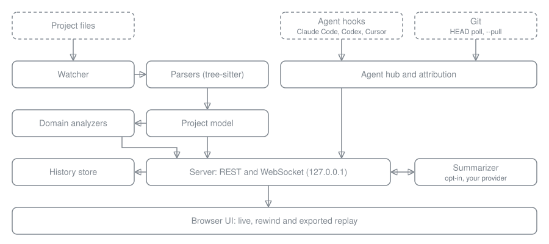

# How LiveMap works

LiveMap is one Node.js process (the engine and server, in `src/`) and one React app (the UI, in `ui/`). The engine keeps a live model of the project in memory, and the server streams every change in that model to the browser.

Dashed boxes are inputs. Everything runs on your machine; only the summarizer, when you turn it on, calls out to a provider.

## Watcher

`src/engine/watcher.ts` watches the project folder with chokidar. Events are debounced per path and handled one at a time, and the model reads the file from disk to decide what happened. It skips what `.gitignore` files ignore, plus common build and dependency folders, and reloads the ignore rules when a `.gitignore` changes.

## Parsers

`src/engine/parser.ts` and `src/engine/symbols/` parse code with tree-sitter (WebAssembly grammars from `tree-sitter-wasms`, of which the build copies the 15 it loads to `dist/grammars/`) for TypeScript, JavaScript, Python, Go, Rust, Java, Kotlin, C#, PHP, Ruby, Swift, C, C++ and Dart. They extract functions, classes, methods and other symbols with their signatures and lines, and `src/engine/imports.ts` resolves imports into links between files. If a file stops parsing cleanly mid-edit, the model keeps its last clean symbols.

## Project model

`src/engine/project.ts` holds every indexed file in memory: its language, symbols, imports and flags (secret, binary, over 1 MB). On each change, `src/engine/differ.ts` compares the old and new file and produces a change summary: symbols added, changed and removed, routes, tables and dependencies, and the diff hunks. `src/engine/usedby.ts` finds where each symbol is used.

## Domain analyzers

`src/engine/domain/` reads routes, screens, schema, dependency manifests, environment variable names and the stack from source text with patterns. Each analyzer runs only on the files it applies to, and `build-index.ts` merges their results into the index behind the Schema, API and Stack tabs. These results are approximate and always point to a source line. The supported frameworks are listed in [the guide](guide.md#what-livemap-understands).

## Agent hooks and git

`src/hook/hook.ts` is the script that agent hooks run. It finds the running LiveMap for the project and posts the event to the server's `/hook` endpoint. `src/agents/` turns hook payloads, Claude Code and Codex transcripts and git commits into one event stream (`hub.ts`), handles Flag and Pause (`control.ts`), and links each file change to the agent action that caused it (`attribution.ts`). `git.ts` polls `HEAD` and, with `--pull`, pulls on an interval. See [agents.md](agents.md).

## Server

`src/server/server.ts` serves the UI and a small REST API on `127.0.0.1`, and pushes messages over a WebSocket. A client first gets `hello`, the whole project state, and then small messages: `files`, `change`, `domain`, `agentEvent`, `agentEvents`, `session`, `control`, `summary` and the like. The events from one transcript read go out together as one `agentEvents` batch, so the UI updates once for them. REST covers file contents (`/api/file`), summaries, history (`/api/history/...`) and steering (`/api/flags`, `/api/pause`). Every API call and the WebSocket need the run's token; see [privacy.md](privacy.md#what-runs-where).

## History store

`src/history/store.ts` appends every message the server broadcasts to one JSONL file per run, and writes gzip snapshots of the full state at each run start and after every fixed number of messages. To show the project at a past moment, it loads the nearest earlier snapshot and replays the messages after it. A size cap removes the oldest runs first.

## Summarizer

`src/summarize/` is optional. When enabled, it asks the configured provider (Anthropic, OpenAI or Ollama) for one-sentence summaries of files and qualifying changes, queues the requests, caches the answers and stops at the monthly token cap. Secret, binary and large files are never sent.

## Browser UI

`ui/` is a React app built with Vite. A Zustand store holds the project state and applies each server message to it. The views are the Activity feed, the Map (React Flow, laid out with ELK), Schema, API and Stack, plus the file tree, the inspector, the timeline and the ⌘K palette. A second build (`npm --prefix ui run build:export`) produces the single-file page that `livemap export` fills with recorded history.

## One reducer

Live, rewind and export all compute project state the same way: start from a state and apply messages in order. `applyMessage` in `src/shared/state.ts` is that function.

| Mode | Where the state comes from |
|---|---|
| Live | The server's `hello`, then each WebSocket message applied as it arrives. |
| Rewind | The history store applies `applyMessage` from the nearest snapshot to the chosen moment, and the UI shows that state. |
| Export | The exported page applies `applyMessage` to the embedded messages, from the start up to the point you scrub to. |

The UI store's own `apply` mirrors `applyMessage` for project data, and a parity test (`ui/src/state-parity.test.ts`) checks that both produce the same state from the same messages. Because every mode uses the same reducer, a rewound or exported view shows the same project state the live view had at that moment.
