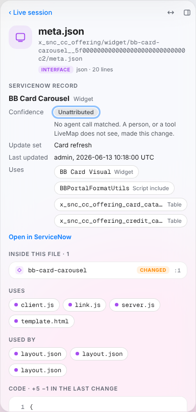
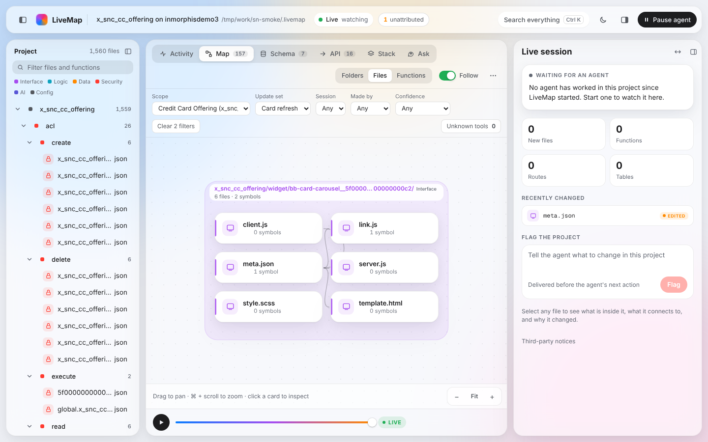

# ServiceNow

LiveMap can show what agents build on a ServiceNow instance. It mirrors one application scope to files on your machine, then shows those records in the same views as a code project: the Map, Schema, Activity and the timeline. Each change shows which agent call made it, how sure LiveMap is, and why the agent made it.

LiveMap only reads from the instance. It never writes to it, and it holds no ServiceNow credentials.

## What it does

- **Mirror.** `livemap sn` reads every record in a scope (portals, pages, widgets, tables, business rules, script includes, ACLs, flows, workspaces and more) and writes each one to a file or folder under `.livemap/sn/<scope>/`.
- **Map.** Records are linked the way the app uses them: a portal to its pages, a page to the widgets it places, a widget to the script includes it calls and the tables it reads, and a rule or ACL to its table.
- **Who changed what.** When an agent changes a record through a tool LiveMap sees, the change is linked to the session and the call that made it. Changes no agent made show as unattributed.
- **Filters.** You can narrow every view to one scope, update set, session, author or confidence level.

## Requirements

- Node.js 18 or later, and LiveMap built from this repo (see [Install from source](../CONTRIBUTING.md#install-from-source)).
- SkyForge running on the same machine, with its nexus MCP server. LiveMap reads the instance through nexus, at `http://127.0.0.1:3006/mcp` by default.
- A ServiceNow user in SkyForge that can read the scope's records.

## First run

From a folder of your choice (an empty one is fine), run:

```
livemap sn --instance acme --scope x_acme_app
```

- `--instance` is the instance name nexus should use. Leave it out to use the instance nexus is set to.
- `--scope` is the app's namespace (`x_acme_app`) or the sys_id of its scope record.
- If nexus listens somewhere else, add `--nexus <url>`.

LiveMap prints the instance, the scope it found and how many records it pulled. It then opens the UI in your browser. A second run on the same folder updates the mirror in place. Every option is listed in the [guide](guide.md#livemap-sn).

## Live mode

While `livemap sn` runs, the UI follows the mirror: when a record's file changes, the Map, the inspector and the activity feed update within a second or two, and the change is attributed if an agent call matches it.

Pulling new changes from the instance while LiveMap runs comes with the live poller, which is still in progress. Until it lands, run `livemap sn` again to pull the latest records.

## Capturing agent calls

LiveMap links a change to an agent call only when it sees the call. There are two ways it sees calls:

- **Desktop MCP client.** Put `livemap mcp-proxy` in front of nexus in the client's MCP config. The proxy passes every call through unchanged and copies the call's details (never the record content) to LiveMap. The steps for Windows are below, and every proxy option is in the [guide](guide.md#livemap-mcp-proxy).
- **SkyForge terminal app.** A small plugin file in SkyForge's plugin folder sends the same details, plus the prompt and the agent's messages. Its setup steps will be added here when the plugin is merged.

Both are fail-open: if LiveMap is not running, calls go through as usual.

### Set up the desktop client proxy (Windows)

You make these changes yourself; LiveMap does not edit the client's config. The examples assume LiveMap is built at `C:\src\livemap`.

1. Quit the desktop client completely, also from the tray icon.
2. Open its MCP config file: in the client, Settings > Developer > Edit Config. This opens the folder under `%APPDATA%` that holds the `..._desktop_config.json` file you edited to add nexus.
3. Back it up. In cmd, from that folder:
   ```
   copy /Y <config file name>.json <config file name>.json.bak
   ```
4. Find the nexus entry under `mcpServers`. It looks like one of these.

   Before (HTTP bridge):
   ```json
   {
     "mcpServers": {
       "skyforge-nexus": {
         "command": "npx",
         "args": ["-y", "mcp-remote", "http://127.0.0.1:3006/mcp", "--header", "X-SN-Instance:<instance>"]
       }
     }
   }
   ```
   Before (stdio command):
   ```json
   {
     "mcpServers": {
       "skyforge-nexus": { "command": "skyforge", "args": ["mcp", "serve"] }
     }
   }
   ```
5. Replace that one entry. Keep the same key, and use doubled backslashes in JSON.

   After (HTTP upstream, recommended):
   ```json
   {
     "mcpServers": {
       "skyforge-nexus": {
         "command": "C:\\Program Files\\nodejs\\node.exe",
         "args": ["C:\\src\\livemap\\dist\\cli.js", "mcp-proxy", "--upstream", "http://127.0.0.1:3006/mcp", "--header", "X-SN-Instance=<instance>"]
       }
     }
   }
   ```
   After (stdio command upstream):
   ```json
   {
     "mcpServers": {
       "skyforge-nexus": {
         "command": "C:\\Program Files\\nodejs\\node.exe",
         "args": ["C:\\src\\livemap\\dist\\cli.js", "mcp-proxy", "--upstream-cmd", "skyforge mcp serve"]
       }
     }
   }
   ```
   Use the full path to `node.exe`: desktop apps do not always see your PATH. `where node` prints it.
6. Save, start the desktop client, and check that the nexus tools are listed as before.

To check it works, run `livemap sn` as in [First run](#first-run), then ask the client for one read, such as "Query 1 active business rule in scope `<scope>`". The answer looks the same as before, and LiveMap's activity feed shows a new MCP client session with the call.

To undo it, quit the client, run `copy /Y <config file name>.json.bak <config file name>.json`, and start it again.

## Reading the inspector

Select any file of a record, for example a widget's `meta.json`, in the file tree or on the Map. The inspector shows a **ServiceNow record** card at the top.



| Row | What it shows |
|---|---|
| Session | The agent and session of the latest change, when an agent made it. |
| Goal | The prompt that started that turn. Long text is cut; click **Show all** to read it all. |
| Step | What the agent said just before the call. |
| Action | The call in plain words, for example "Updated business rule via record manage". |
| Confidence | How sure LiveMap is about who made the change. Hover the badge to see why. |
| Update set | The update set the record is in, when the mirror records it. |
| Last updated | Who last updated the record on the instance, and when (UTC). |
| Uses | The script includes, widgets and tables the record uses. Click one to open it. |

Goal and Step need the conversation, which only the SkyForge terminal plugin sends. For calls from a desktop MCP client, the card shows the Action and the update set instead.

**Open in ServiceNow** opens the record on the instance in a new tab; hover it to see the host. It is a plain link: LiveMap does not change anything on the instance. It links only to ServiceNow's own domains (`service-now.com` and `servicenowservices.com`), because the instance name comes from the mirror folder, which anything that can write to it could change. For an instance on another domain, start LiveMap with `LIVEMAP_SN_HOSTS` set to that domain, for example `set LIVEMAP_SN_HOSTS=sn.example.com` in cmd (separate several with commas).

### Confidence levels

From strongest to weakest:

| Level | Meaning |
|---|---|
| Exact | The agent call named this record (its sys_id, or its table and name). |
| Log | The change matched a line in SkyForge's tool log by table, action and time. |
| Likely | One agent session fits, by update set, script run window or time. |
| Ambiguous | More than one session fits. The card lists each candidate. |
| Unattributed | No agent call matched. A person made the change, or a tool LiveMap does not see. |

## Filters

The filter bar sits above the views of a ServiceNow project.



| Filter | Keeps |
|---|---|
| Scope | Records in that scope. |
| Update set | Records in that update set. |
| Session | Changes made in that agent session, and the files they touched. |
| Made by | Changes made by an agent, or by a human (no agent matched). |
| Confidence | Changes with that confidence level. |

Filters apply to the Map, Schema, Activity and the inspector's change list and diff. The timeline above the feed always shows the whole history. Your choices are kept in the page address, so a reload or a copied link shows the same view. The **Clear** button removes them all.

## Unattributed changes and diagnostics

The toolbar shows how many changes no agent call was matched to, for example **3 unattributed**. Click it to show only those changes; click it again to show everything.

**Unknown tools** in the filter bar lists the tool names LiveMap could not classify, with how many times each was called. Calls to these tools never count as writes, so the changes they make stay unattributed. A new SkyForge tool shows up here first.

## What LiveMap never reads

- Credential records (`sys_auth_profile*`, `oauth_entity*`, `discovery_credentials`). They are listed by name only.
- Fields named like passwords, secrets, tokens or keys, including `password2` fields.
- The values of system properties (`sys_properties`). Their names are kept, their values are not.

The mirror folder is readable only by you. When the folder is inside a git repository, LiveMap adds `.livemap/` to its `.gitignore`.

## Troubleshooting

**"nexus is not reachable at ..." and "Is SkyForge running?"** LiveMap could not connect to nexus. Start SkyForge and check that its MCP server is on. If it uses another address, pass it with `--nexus`.

**The instance does not answer.** nexus is running but the instance is offline, asleep or not reachable. The pull stops with the error nexus reports, and the mirror from the last run stays as it was. Wake the instance (a developer instance can sleep), then run `livemap sn` again.

**No Open in ServiceNow link.** The card says the host is not a ServiceNow domain. Set `LIVEMAP_SN_HOSTS` to the instance's domain and start `livemap sn` again.

**Nothing is attributed.** Every change shows as unattributed:

- Check that the proxy or the plugin is set up. Once it is, each agent session shows in LiveMap's activity feed after its first call.
- Look at **Unknown tools**. If the agent's write tools are listed there, LiveMap cannot tell they are writes yet.
- Changes made in the ServiceNow UI by a person are unattributed by design.

**Third-party notices.** The licenses of the open source packages LiveMap uses are linked from the inspector's Live session view (**Third-party notices**).
